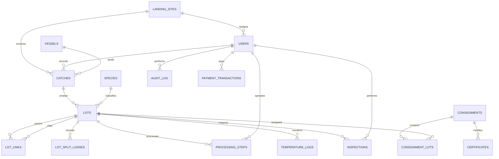

# Database Schema and Relationships

The application uses PostgreSQL (Supabase) with versioned SQL scripts in [`backend/migrations/`](../backend/migrations/). The migrations use UUID primary keys and foreign keys for relational integrity.

## Relationship diagram

`LOT_LINKS` is the many-to-many genealogy edge table: each row relates a parent lot to a child lot. A catch-created lot points to a `CATCH`; a lot created by a merge can have no direct `catch_id` and is traced through its `lot_links`. `CONSIGNMENT_LOTS` is the join table between lots and consignments. The `role` is stored on `USERS`; there is no separate roles table.

## Table reference

| Table | Purpose / main relationships |
|---|---|
| `landing_sites` | Site name, region, coordinates, active flag. Referenced by users and catches. |
| `users` | Email, bcrypt password hash, role, optional assigned landing site. |
| `vessels` | Registration/licence, owner, home port, vessel and gear information. |
| `species` | Species catalogue and protected-species flag. |
| `catches` | Vessel, recording officer, landing site, dates, area, gear, first temperature. |
| `lots` | Traceable product unit, species, current weight/status, optional originating catch and optional legacy parent link. |
| `lot_links` | Parent-child genealogy for split and merge operations. |
| `lot_split_losses` | Recorded split loss and optional reason for each parent lot. |
| `processing_steps` | Lot, operator, process type, input/output weights, calculated yield. |
| `temperature_logs` | Lot, temperature/storage type, time, location, breach flag. |
| `inspections` | Lot, inspector, grade, pass/fail, notes/photo URL, inspection timestamp. |
| `consignments` | Buyer, destination, ship date, container/flight, status and lock flag. |
| `consignment_lots` | Join between consignments and the lots they contain. |
| `certificates` | Consignment certificate issuance/revocation fields in the initial SQL schema. |
| `audit_log` | Optional user, action, entity UUID, timestamp for sensitive operations. |
| `sms_outbox` | Mock queued SMS destination, message, timestamp, status. |
| `payment_transactions` | Mock payment provider, amount, reference, receipt/transaction ID, user and timestamp. |

## Migration order

1. `001_init.sql` — core relational schema, indexes, and row-level security enablement.
2. `002_seed.sql` — demo roles/accounts, Somali sites, protected species, and vessels.
3. `003_traceability_queries.sql` — traceability query functions/views used by the app.
4. `004_lot_workflows.sql` — nullable catch origin for merged lots, split loss, SMS outbox, consignment status.
5. `005_processing_export_audit.sql` — inspection timestamps and audit log.
6. `006_temperature_type.sql` — chilled/frozen classification for temperature readings.
7. `007_mock_payments.sql` — simulated payment receipt table.

Always inspect the scripts and confirm the target is a development database before applying them. The numbered scripts are the migration history; there is no separate automatic migration runner in the current setup.
